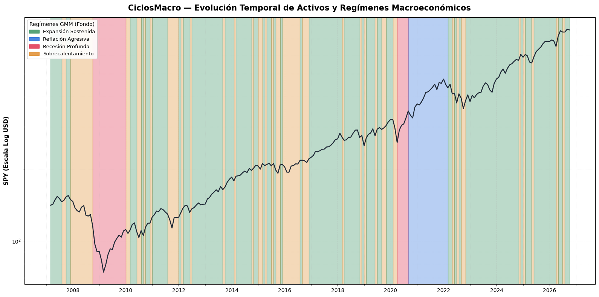

# CiclosMacro

**CiclosMacro** es un pipeline cuantitativo no supervisado diseñado para identificar, clasificar y monitorear regímenes macroeconómicos y de mercado en Estados Unidos. El sistema combina técnicas de reducción de dimensionalidad (PCA) y modelos probabilísticos de mixturas gaussianas (GMM) para modelar dinámicas cíclicas complejas.



---

## 🎯 Objetivos del Proyecto

- **Evitar el ruido de corto plazo:** Sustituir la predicción direccional univariada de activos por la detección estructural del entorno macroeconómico.
- **Modelado sin sesgo de anticipación (*Lookahead Bias*):** Incorporar desfases temporales adecuados (*publication lags*) en series macroeconómicas de baja frecuencia (FRED) combinadas con datos de mercado (Yahoo Finance).
- **Tratamiento no lineal de asimetrías:** Preservar la información de shocks y crisis financieras evitando la mutilación de datos por filtros agresivos de *outliers*.
- **Estimación de regímenes probabilísticos:** Proveer probabilidades suaves de pertenencia a estados macroeconómicos en lugar de clasificaciones discretas rígidas.

---

## 🏗️ Arquitectura del Pipeline

El flujo de procesamiento sigue una secuencia modular de cuatro etapas:

```
[Datos FRED + Yahoo Finance]
            │
            ▼ (Alineación mensual 'ME' + Publication Lags)
[Feature Engineering: Retornos 1m/12m y Deltas]
            │
            ▼ (Yeo-Johnson en variables con asimetría |skew| > 2.0)
[Estandarización: StandardScaler]
            │
            ▼ (Reducción dimensional)
[PCA (3 Componentes Principales - ~50% Varianza Explicada)]
            │
            ▼ (Clustering probabilístico)
[Gaussian Mixture Model (k=4, covariance_type='diag')]
            │
            ▼
[Asignación de Regímenes + Probabilidades Blandas (predict_proba)]
```

### 1. Variables y Fuentes de Datos

- **Mercados y Precios (Yahoo Finance):**
  - S&P 500 (`SPY`), Oro (`GC=F`), Petróleo Crudo (`CL=F`), Índice Dólar (`DXY`).
  - Volatilidad implícita (`^VIX`) y variaciones mensuales/anuales.
- **Series Macroeconómicas (FRED):**
  - Rendimiento real del Tesoro a 10 años (`DFII10`).
  - Índice de estrés financiero de St. Louis (`STLFSI4`).
  - Oferta monetaria M2 (`M2SL`, *lag 1m*).
  - Tasa de desempleo (`UNRATE`, *lag 1m*).
  - Producción Industrial (`INDPRO`, *lag 1m*).
  - Inflación general IPC (`CPIAUCSL`, *lag 1m*).
  - Tasa efectiva de fondos federales (`FEDFUNDS`, *lag 1m*).

### 2. Preprocesamiento Matemático

- **Filtro de Colinealidad:** Eliminación de redundancias temporales de corto plazo (p. ej. exclusión del cambio trimestral de Fed Funds en favor del cambio a 12 meses).
- **Transformación de Potencia de Yeo-Johnson:** Aplicada sobre series con colas pesadas (`vix_index`, `st_louis_financial_stress`, aceleración de desempleo) para estabilizar varianzas sin suprimir los shocks de crisis.
- **PCA (3 Dimensiones Latentes):**
  - **$\text{PC}_1$ (Ciclo Económico Fundamental):** Producción industrial, bolsa anual y tasas vs. desempleo y estrés.
  - **$\text{PC}_2$ (Sentimiento de Mercado / Risk-On táctico):** Retornos a 1 mes de SPY y Petróleo vs. Dólar y saltos de volatilidad mensual.
  - **$\text{PC}_3$ (Régimen de Liquidez / Reflación):** Expansión monetaria M2 y retornos tendenciales vs. tasas reales.

---

## 📊 Regímenes Macroeconómicos Identificados

El modelo GMM configurado con covarianza diagonal (`covariance_type='diag'`) clasifica la historia económica en cuatro cuadrantes operativos:

| Régimen | Nombre Económico | % Histórico | Entorno Macro y Política Monetaria | Dinámica de Activos |
| :---: | :--- | :---: | :--- | :--- |
| **0** | **Expansión Sostenida (*Goldilocks*)** | ~57.6% (136 m) | Volatilidad y estrés en mínimos, inflación anclada (~2.6%), subas graduales de tasas por la Fed. | **Renta Variable Alcista:** SPY rindiendo $+14.5\%$ anualizado con baja volatilidad. |
| **1** | **Reflación Agresiva (*Boom de Liquidez*)** | ~7.6% (18 m) | Expansión masiva de M2 ($+18.9\%$), tasas reales muy negativas ($-0.91\%$), recuperación del empleo. | **Rally de Activos Reales:** Petróleo ($+58.5\%$ anual) y SPY ($+27.5\%$ anual). |
| **2** | **Recesión Profunda (*Bear Market* Estructural)** | ~8.5% (20 m) | Paro disparándose, colapso industrial ($-10.8\%$), estrés y VIX en máximos, recortes agresivos de la Fed. | **Flight to Safety:** Caída severa en SPY ($-18.5\%$) y Petróleo; el **Oro destaca como refugio** ($+15.4\%$). |
| **3** | **Fin de Ciclo / Sobrecalentamiento y Fricción** | ~26.3% (62 m) | Estrés financiero y VIX elevados con saltos mensuales bruscos ($+19.4\%$), crecimiento estancado. | **Corrección Táctica:** SPY mensual en promedio negativo ($-2.4\%$), subida del Dólar. Alerta temprana. |

---

## 🚀 Uso Rápido

1. Clona este repositorio en tu máquina local:
   ```bash
   git clone https://github.com/sebakremis/CiclosMacro.git
   cd CiclosMacro
   ```

2. Instala el entorno de dependencias requerido utilizando `pip`:
   ```bash
   pip install -r requirements.txt
   ```

3. Gestiona la clave API gratuita de la Reserva Federal en el sitio oficial (https://fredaccount.stlouisfed.org/). Luego sigue las instrucciones del fichero `src/data_sources.example.py`.

4. Ejecuta los notebooks según su orden.

---

### Estructura del Proyecto

```text
CICLOSMACRO/
├── data/                            # Almacenamiento local de datasets
├── images/                          # Gráficos
├── src/                             # Sub-directorio con los módulos de funciones auxiliares
│   ├── __init__.py                  # Fichero vacío, inicializa la carpeta como paquete
│   ├── config.py                    # Configuración global del proyecto
│   ├── data_sources.example.py      # Fichero ejemplo para gestionar la clave API de Fred
│   ├── extract.py                   # Módulo de la fase de extracción
│   ├── modeling_functions.py        # Funciones para la fase de modelado
│   └── preprocessing_funcions.py    # Funciones para la fase de pre-procesado
├── .gitignore                       # Reglas de git ignore
├── 01_Preprocessing.ipynb           # Notebook del pre-procesamiento de datos
├── 02_Modeling.ipynb                # Notebook de modelado
├── LICENSE                          # Licencia del proyecto
├── README.md                        # Descripción del proyecto
└── requirements.txt                 # Dependencias necesarias
```

---

## 📜 Licencia
Este repositorio se encuentra bajo una licencia de código abierto **MIT**. 
Puedes usar, modificar y distribuir el código libremente para cualquier propósito.

Para obtener más información, consulta el archivo [LICENCIA MIT](LICENSE).
